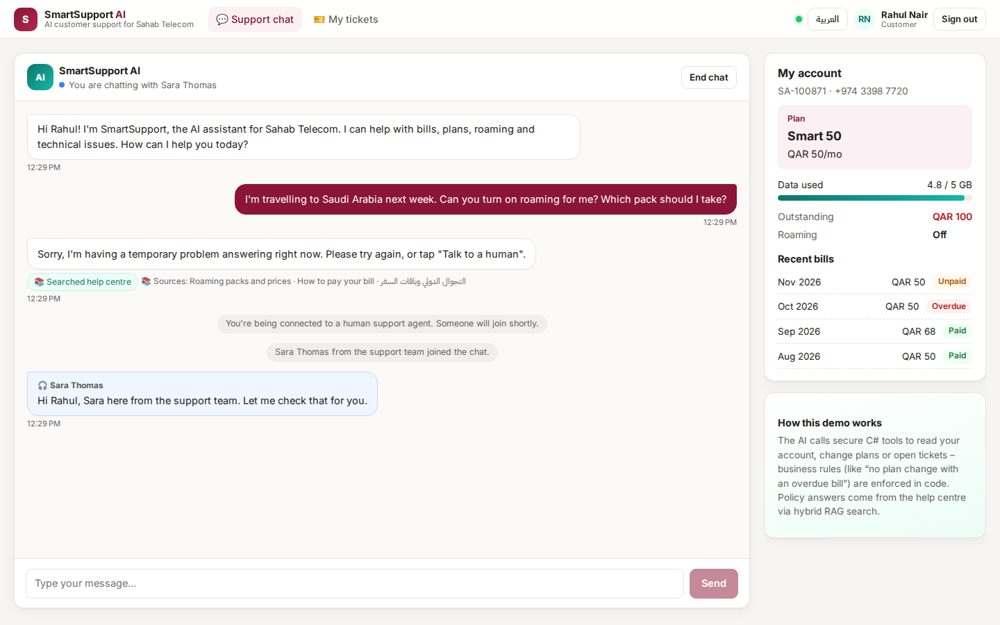
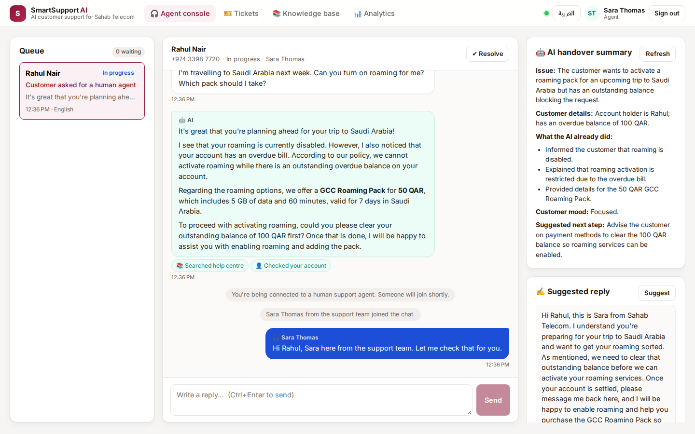
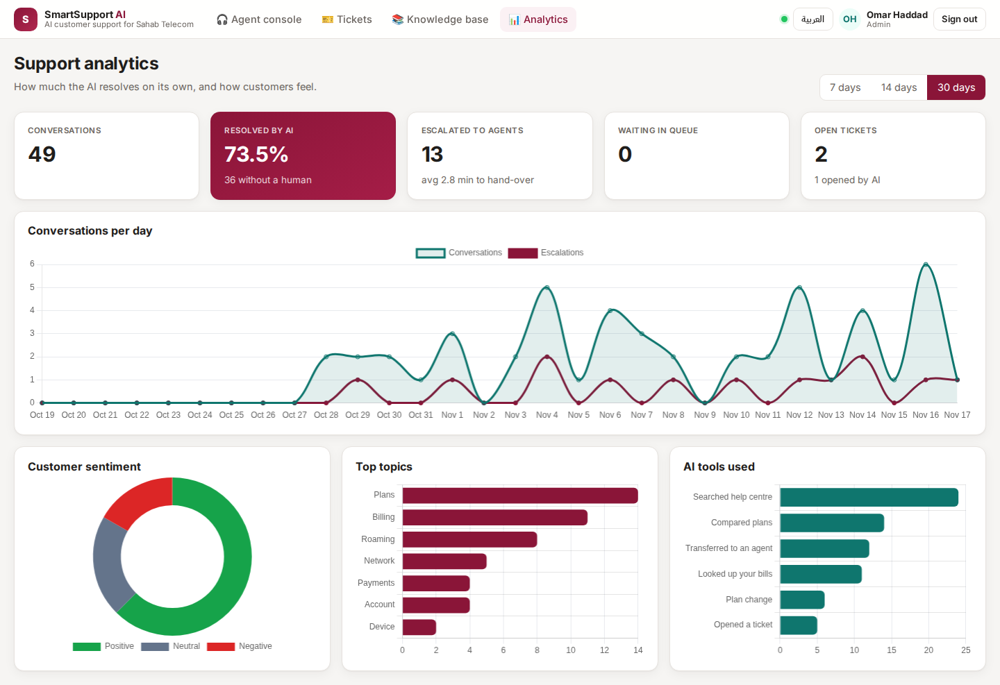
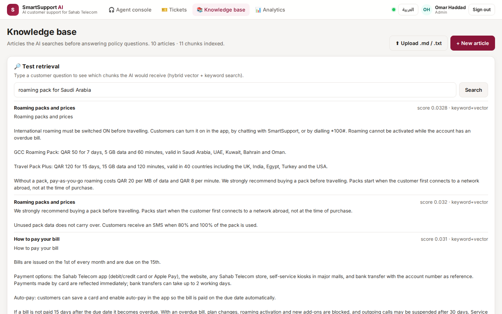
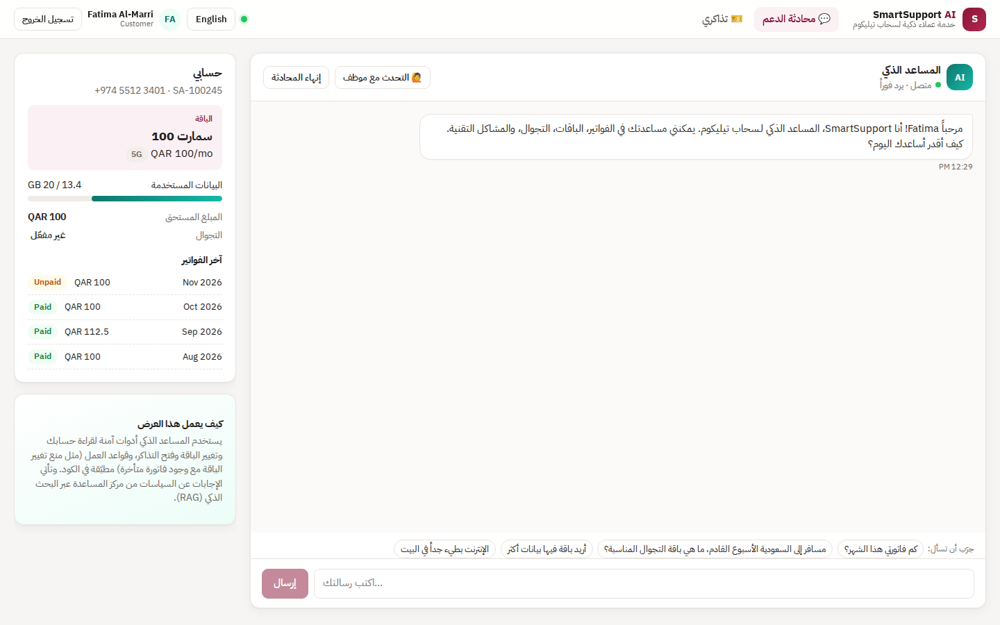

<h1 align="center">SmartSupport AI</h1>
<p align="center"><b>AI-first customer support platform with human hand-over</b><br/>
ASP.NET Core 10 · Angular 22 · PostgreSQL + pgvector · SignalR · Microsoft.Extensions.AI · Docker</p>

<p align="center">
  <a href="../../actions/workflows/ci.yml"></a>
  <a href="../../actions/workflows/e2e.yml"></a>
</p>

SmartSupport AI is a customer support system for **Sahab Telecom**, a fictional mobile operator in Qatar.
Customers chat with an **AI agent** in **Arabic or English**. The agent does more than answer questions: it
reads the customer's bills, changes plans, turns roaming on, and opens tickets by calling **secure C# tools**.
It answers policy questions from the help centre using **RAG (hybrid vector + keyword search)**.
When the AI can't help, or the customer asks for a person, the chat is **handed over live to a human agent**.
The agent gets an AI-written handover summary and suggested replies.

<p align="center"></p>

---

## ✨ Features

| | |
|---|---|
| 🤖 **AI agent with tool calling** | The LLM calls 9 C# functions (`get_recent_bills`, `change_plan`, `create_support_ticket`, `escalate_to_human_agent`...) through **Microsoft.Extensions.AI**. Each tool is limited to the logged-in customer's own data. |
| 🛡️ **Business rules in code, not in the prompt** | "No plan change while a bill is overdue" and "ask the customer to confirm before changing anything" are enforced in domain methods and tool logic. The model cannot get around them. |
| 📚 **RAG with hybrid search** | Help-centre articles are chunked and embedded in a background worker and stored in **pgvector** (HNSW index). Search combines semantic and **PostgreSQL full-text** results with **Reciprocal Rank Fusion**. Answers show their sources. |
| ⚡ **Real-time streaming** | AI answers stream token by token over **SignalR**. Customers see live "Looking up your bills..." tool activity. |
| 🙋 **Human-in-the-loop** | Escalated chats appear instantly in the agent queue. Agents accept a chat, reply live, and use an **AI handover summary** and **suggested replies** grounded in the knowledge base. |
| 🌐 **Arabic & English** | Language is detected per message. The UI switches to **right-to-left** and the AI replies in the customer's language. |
| 📊 **Analytics** | AI resolution rate, escalations, average time to hand-over, and **LLM-classified sentiment and topics** (background job). Shown in Chart.js dashboards. |
| 🔐 **Security** | JWT auth with role-based access (Customer / Agent / Admin), a SignalR auth token, rate-limited login, and ProblemDetails errors. |
| 🧪 **Tested** | 42 xUnit tests, Vitest unit tests, an API smoke test against real PostgreSQL in CI, and **Playwright E2E tests** that run the full customer → AI → agent journey in Docker. |

## 🏗️ Architecture

```mermaid
flowchart LR
    subgraph Browser["Angular 22 (signals, standalone, lazy routes)"]
        C[Customer chat]
        A[Agent console]
        D[Admin: knowledge & analytics]
    end

    C & A & D -- REST + JWT --> API
    C & A <-- SignalR: tokens, tool activity, messages --> HUB

    subgraph API["ASP.NET Core 10 API (Clean Architecture)"]
        API[Controllers]
        HUB[SupportHub]
        AG[SupportAgent<br/>+ SupportTools]
        KS[Hybrid knowledge search<br/>vector + full-text + RRF]
        W1[[Indexing worker]]
        W2[[Insights worker]]
    end

    AG -- IChatClient + function calling --> LLM[(Google Gemini 3.1 Flash-Lite<br/>or OpenAI / Azure OpenAI)]
    W1 -- embeddings --> EMB[(gemini-embedding-001)]
    API & AG & KS & W1 & W2 --> DB[(PostgreSQL 17 + pgvector)]
```

```
backend/
 ├─ src/SmartSupport.Domain          Entities + business rules (Conversation state machine, plan-change rules)
 ├─ src/SmartSupport.Application     Use cases, AI SupportAgent + tools, prompts, chunking, DTOs
 ├─ src/SmartSupport.Infrastructure  EF Core + pgvector, hybrid search, LLM providers, background workers, seed data
 ├─ src/SmartSupport.Api             Controllers, SignalR hub, JWT, OpenAPI (Scalar), exception handling
 └─ tests/SmartSupport.UnitTests     xUnit
frontend/                            Angular 22 app (customer, agent, admin)
e2e/                                 Playwright tests against the Docker stack
```

**How one AI reply works**

1. The customer sends a message over SignalR, and `ConversationService` saves it.
2. `SupportAgent` builds the prompt (system rules + the last 20 messages) and passes `SupportTools` to the model.
3. The `FunctionInvokingChatClient` runs the tool loop: the model asks for `get_recent_bills`, the C# method runs, the result goes back to the model, and so on.
4. The final answer streams to the browser token by token and is saved with the tools used and the knowledge sources.

More detail is in **[docs/HOW-THE-BACKEND-WORKS.md](docs/HOW-THE-BACKEND-WORKS.md)**.

## 🚀 Run it

**Requirements:** Docker Desktop. For real AI answers you also need a **free** [Google Gemini API key](https://aistudio.google.com/apikey) (no credit card). The same key is used for the chat model and for embeddings.

```bash
git clone https://github.com/1999Anjali1/ai-customer-support-platform.git
cd ai-customer-support-platform
cp .env.example .env          # paste your GEMINI_API_KEY
docker compose up --build
```

Open **http://localhost:4200**. API docs are at **http://localhost:5080/scalar**.

| Demo user (password `Demo@123`) | Role | Try this |
|---|---|---|
| `rahul@demo.qa` | Customer | "Can I upgrade my plan?" (the AI explains it's blocked by an overdue bill) |
| `fatima@demo.qa` | Customer | Ask in Arabic: «مسافرة إلى السعودية، ما هي باقة التجوال؟» |
| `sara@demo.qa` | Agent | Accept escalated chats, use the AI summary and suggested replies |
| `admin@demo.qa` | Admin | Analytics, add or upload knowledge articles, test retrieval |

> Without an API key the app still runs in **demo mode**: everything works except the AI answers.
> Gemini is called through its **OpenAI-compatible endpoint**, so switching to OpenAI, Azure OpenAI, Groq or Ollama is configuration only (see `.env.example`).
> For free local embeddings, run with `--profile local-embeddings` (Ollama). See `docker-compose.yml`.

<details>
<summary><b>Run without Docker (for development)</b></summary>

```bash
# 1. PostgreSQL with pgvector
docker compose up -d db

# 2. API  → http://localhost:5080
cd backend
dotnet user-secrets init --project src/SmartSupport.Api
dotnet user-secrets set "AI:Chat:ApiKey" "<your-gemini-key>" --project src/SmartSupport.Api
dotnet run --project src/SmartSupport.Api

# 3. Angular → http://localhost:4200 (proxies /api and /hubs to the API)
cd ../frontend
npm install
npm start
```
</details>

## 🧪 Tests

```bash
cd backend  && dotnet test            # domain rules, chunking, search query builder, RRF, prompt building
cd frontend && npm test               # i18n/RTL, markdown rendering, SignalR error handling
cd e2e      && npx playwright test    # full journey against `docker compose up`
```

GitHub Actions runs all of these on every push. It also starts the API against a real PostgreSQL + pgvector database and calls the main endpoints.

## 📸 Screenshots

| Agent console with AI copilot | Analytics |
|---|---|
|  |  |
| **Knowledge base & retrieval testing** | **Arabic (RTL)** |
|  |  |

## 🧰 Tech stack

**Backend:** C# 14, ASP.NET Core 10 Web API, EF Core 10, Npgsql, pgvector, SignalR, Microsoft.Extensions.AI, OpenAI .NET SDK, JWT Bearer, OpenAPI + Scalar, BackgroundService + Channels, rate limiting, xUnit<br/>
**Frontend:** Angular 22 (standalone components, signals, new control flow, lazy routes, functional guards/interceptors), TypeScript, SCSS, @microsoft/signalr, Chart.js, marked, Vitest<br/>
**AI:** Google Gemini 3.1 Flash-Lite via the OpenAI-compatible API (swappable for OpenAI / Azure OpenAI), gemini-embedding-001 embeddings (768-d), tool calling, RAG, structured classification<br/>
**DevOps:** Docker multi-stage builds, Docker Compose, Nginx reverse proxy (WebSockets), GitHub Actions CI, Playwright E2E

## 🗺️ Possible next steps

- Azure deployment (App Service / AKS + Azure Database for PostgreSQL + Azure OpenAI) with Terraform
- Voice input (Whisper) and WhatsApp channel integration
- PDF/Word ingestion for the knowledge base
- Per-tenant data isolation for multiple operators

---

<sub>Sahab Telecom is fictional. All customers, bills and policies are demo data.</sub>
